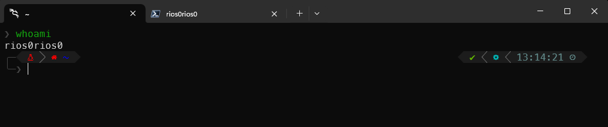
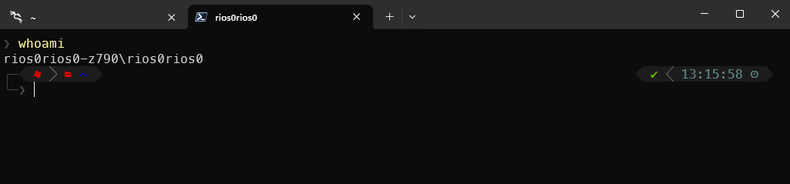
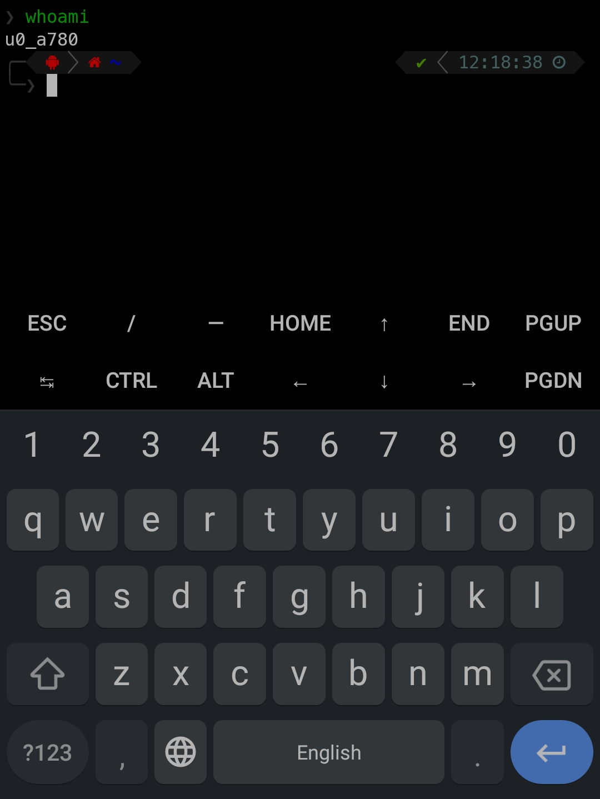

<h1 align="center">dotfiles</h1>
<p align="center">
    <a href="https://github.com/rios0rios0/dotfiles/releases/latest">
        </a>
    <a href="https://github.com/rios0rios0/dotfiles/blob/main/LICENSE">
        </a>
    <a href="https://github.com/rios0rios0/dotfiles/actions/workflows/validate.yaml">
        </a>
    <a href="https://sonarcloud.io/summary/overall?id=rios0rios0_dotfiles">
        </a>
    <a href="https://sonarcloud.io/summary/overall?id=rios0rios0_dotfiles">
        </a>
    <a href="https://www.bestpractices.dev/projects/12024">
        </a>
</p>

Cross-platform dotfiles managed with [chezmoi](https://www.chezmoi.io/), [1Password CLI](https://developer.1password.com/docs/cli/) for secrets, and [age](https://github.com/FiloSottile/age) for file encryption. Targets three platforms: **Linux (Kali on WSL)**, **Windows 11**, and **Android (Termux)**.





## What's Managed

### Shells and Prompt

| Component | Linux (WSL) | Windows | Android (Termux) |
|-----------|-------------|---------|------------------|
| Shell | Zsh | PowerShell 7 | Zsh |
| Framework | Oh My Zsh + ZINIT | Oh My Posh | Oh My Zsh + ZINIT |
| Theme | Powerlevel10k | Oh My Posh (custom) | Powerlevel10k |
| History | Atuin, synced through our own server | PowerShell's own | Atuin, synced through our own server |

### Version Managers

- **GVM** (Go), **NVM** (Node.js), **Pyenv** (Python), **SDKMAN** (Java, Gradle, Maven, Kotlin), **Cargo** (Rust)
- **Flutter** (the stable SDK, with the Dart it bundles): on Linux/WSL the official tarball, resolved from Flutter's releases manifest and checked against the SHA-256 it publishes, under `~/.local/share/flutter` with `flutter` and `dart` linked into `~/.local/bin`; on Android, Termux's own `dart` package plus a pinned community `.deb` (Flutter ships no Linux arm64 host SDK) — see the [fresh-machine runbook](.docs/fresh-machine-setup.md) for exactly what that trusts
- Automatic version switching via `dot_scripts/linux-engineering-version-manager.sh` (detects `go.mod`, `.nvmrc`, `pyproject.toml`)

### Cloud and Infrastructure

- **Kubernetes**: kubectl, krew (ctx/ns plugins), kubeconfig auto-detection
- **Terraform** + Terragrunt
- **AWS CLI**, **Azure CLI**, **Fly.io CLI**, **OCI CLI** (Oracle Cloud), **GitHub CLI**, **Atlassian CLI**
- **Docker** + Docker Compose

### Development Tools

- AI coding assistant: **Claude Code** (Linux/WSL and Android; on Linux, Anthropic's native build, which updates itself)
- **OpenCode**, as `ocode` on Linux: a build of the [`rios0rios0/opencode`](https://github.com/rios0rios0/opencode) fork that `chezmoi apply` makes from a local checkout, with a local **OmniRoute** gateway as its primary provider -- a digest-pinned build of the [`rios0rios0/OmniRoute`](https://github.com/rios0rios0/OmniRoute) fork, published to GHCR, in front of a GPU's Ollama model and cloud providers such as NVIDIA NIM and OpenRouter -- discovering the models the API key allows from the gateway itself, with the Claude Code permission set, the context7 and Chrome DevTools (Linux) MCP servers and the terminal look; see the [OpenCode guide](.docs/opencode-local.md) and the [OmniRoute guide](.docs/omniroute-local.md)
- **Tailscale**: Windows' client on Windows and its WSL, which reaches it through a `tailscale` wrapper; `tailscaled` on bare-metal Linux, installed and logged in by `chezmoi apply` and rejoined by every interactive zsh; OmniRoute reaches another machine's GPU across it
- **Sentry CLI** (`sentry`, from [getsentry/cli](https://github.com/getsentry/cli); Linux/WSL and Android, installed from npm); `sentry-ds` runs it on the work account, from a login store of its own (log in once with `sentry-ds auth login`), which needs CLI `0.47.0` or newer: `chezmoi apply` upgrades an older one
- **Neon CLI** (`neon`, the [Neon Serverless Postgres](https://neon.com) CLI; Linux/WSL and Android, installed from npm — fresh installs take the `neon` package, not the legacy `neonctl` compatibility shim)
- **Neovim** with AstroVim (Android)

### Security and Pentesting

- John the Ripper, SQLMap, VHostScan, dirsearch, StegCracker, stegbrute

### Utilities

- eza (ls replacement), bat (syntax highlighting), ripgrep, jq/yq, ffmpeg, SoX (audio recording, backs Claude Code voice input on WSL), pdftk (Windows and baremetal Linux only), asciinema, Speedtest CLI, rclone (Android/Termux only; see the [OneDrive setup guide](.docs/rclone-onedrive-setup.md))
- **`top-size [count] [depth: 1-3] [dir]`**: the biggest entries under a directory, largest first and hidden ones included (by default 5 entries one level below the current directory), read through `sudo` where it exists so that what only root can read counts too

## Platform Matrix

| Aspect | Linux (WSL/Kali) | Windows 11 | Android (Termux) |
|--------|------------------|------------|------------------|
| Shell | Zsh + Oh My Zsh + p10k | PowerShell + Oh My Posh | Zsh + Oh My Zsh + p10k |
| Scripts | `.sh` (bash) | `.ps1` (PowerShell) | `.sh` (bash) |
| 1Password | `op` wrapper (calls `op.exe` from WSL, retrying a call the app turns away) | Native `op.exe` (chezmoi runs it itself, so one approval covers an apply) | `op` wrapper (`termux-etc-seccomp`) |
| Docker | Native | Docker Desktop | N/A (proot wrappers) |
| MCP Config | `~/.claude.json` (Context7, Chrome DevTools) | N/A (no Claude Code) | `~/.claude.json` and `~/.config/mcphub/servers.json` (Context7) |
| Editor | Any | Notepad++ | Neovim (AstroVim) |

## Installation

Setting up a machine from nothing? Follow the [fresh-machine setup runbook](.docs/fresh-machine-setup.md). It orders every step across Windows, WSL and Termux, names the script behind each automated item, and lists what stays manual. The blocks below are the short version for a machine that already has its prerequisites.

### Prerequisites

All platforms require:
- [Git](https://git-scm.com/book/en/v2/Getting-Started-Installing-Git)
- [age](https://github.com/FiloSottile/age)
- [1Password CLI](https://developer.1password.com/docs/cli/get-started)

### Kali Linux on WSL

```sh
sudo apt install git age
sh -c "$(curl -fsLS get.chezmoi.io/lb)" -- init --apply rios0rios0
```

### PowerShell 7 on Windows

Everything here is installed with winget, so set it up first, from Windows PowerShell:

1. **Install winget.** Download `Microsoft.DesktopAppInstaller_8wekyb3d8bbwe.msixbundle` from the [latest winget-cli release](https://github.com/microsoft/winget-cli/releases/latest) and install it with `Add-AppxPackage .\Microsoft.DesktopAppInstaller_8wekyb3d8bbwe.msixbundle`. If that reports a missing dependency, run `Add-AppxPackage` on each `x64` package in `DesktopAppInstaller_Dependencies.zip`, from the same release, and then try again.
2. **Put it on `PATH`.** Add `C:\Users\<USER>\AppData\Local\Microsoft\WindowsApps` to your user `Path` variable, where `<USER>` is your Windows user name: Start > "Edit environment variables for your account" > `Path` > Edit > New. The `winget.exe` alias lives in that folder.
3. **Restart the terminal.** Close it and open a new one, which reads the new `Path`, and check that `winget --version` answers.

Then install the rest and apply:

```powershell
winget install Microsoft.PowerShell
winget install Git.Git           # if ASLR is enabled, install from https://git-scm.com/download/win
winget install FiloSottile.age   # add the age executable to PATH manually
winget install 1password-cli
winget install twpayne.chezmoi

Set-ExecutionPolicy RemoteSigned -Scope Process
chezmoi init --apply rios0rios0
```

Windows Terminal forwards **Ctrl+V** to the running application as `\u0016` instead of pasting, so an application that reads the clipboard itself (to attach an image, for instance) receives the key. Use **Ctrl+Shift+V** for normal terminal paste. These bindings apply to all Windows Terminal profiles and are deployed by the Windows chezmoi configuration; run `chezmoi update` from PowerShell to sync them on an existing computer.

### Termux on Android

> **Important**: Install Termux from [F-Droid](https://f-droid.org/en/packages/com.termux/), not the Play Store ([reason](https://www.reddit.com/r/termux/comments/zu8ets/do_not_install_termux_from_play_store/)).

```sh
apt install git chezmoi
chezmoi init --apply rios0rios0
```

> **Note**: Full dependency installation takes 45-120 minutes. Do not cancel mid-execution.

## Repository Structure

```
.chezmoiscripts/         # Platform-specific setup scripts (run_before_*, run_once_before_*, run_after_*, run_onchange_after_*)
.chezmoiremove           # Target paths deleted from $HOME on every apply (see Dependency Lifecycle)
.chezmoitemplates/       # Shared template fragments (shared install functions, font installer, dependency removal, Sentry CLI version floor, MCP server logic, Claude Code look, username)
dot_claude/              # Claude Code config (the look and status line on Linux; permissions and trust on Android) -> ~/.claude/
dot_config/              # XDG config (mcphub MCP servers for Android; systemd user units for the WSL SSH agent bridge) -> ~/.config/
dot_docker/              # Docker daemon config -> ~/.docker/
dot_local/bin/           # Executable user commands -> ~/.local/bin/ (platform-filtered)
dot_scripts/             # Utility scripts (version manager, credential loader, git sync, etc.)
dot_ssh/                 # SSH config, keys, signing (1Password-backed) -> ~/.ssh/
dot_aws/                 # Encrypted AWS credentials -> ~/.aws/
dot_azure/               # Encrypted Azure profile -> ~/.azure/
AppData/                 # Windows Terminal settings, and Docker Desktop's WSL integration and start at sign-in, merged into its own settings (Windows only)
modify_dot_claude.json   # MCP server config for Claude Code (Linux, Android) -> ~/.claude.json
```

Chezmoi translates `dot_` prefixes to `.` in the target path (e.g., `dot_zshrc.tmpl` becomes `~/.zshrc`), and `private_` strips group and world permissions from the target (e.g., `dot_config/private_aisync/` becomes `~/.config/aisync` with mode `0700`).

## Secrets and Encryption

This repository uses a layered approach to secrets management:

- **1Password CLI** fetches SSH keys, GPG keys, and credentials at template render time via `onepasswordRead` / `onepassword` template functions
- **Age encryption** protects sensitive files at rest (AWS, Azure, Kubernetes configs, npmrc). Private key stored at `~/.ssh/chezmoi`, recipients at `~/.age_recipients`. The key is the `chezmoi.age` item in 1Password, a key of its own rather than the SSH key that signs commits, and `chezmoi apply` fetches it before any file whenever it is missing or out of date
- **Per-device SSH/GPG signing** matches keys by hostname against 1Password device notes ("Device: \<hostname\>")
- **Machine-local Git config** stays out of this public repository: `~/.gitconfig` ends with an `[include]` of `~/.gitconfig.local`, an unmanaged file for settings such as a work identity selected by `includeIf` (Git skips the include when the file does not exist)

Encrypted files end in `.age` and are automatically decrypted during `chezmoi apply`.

## SSH Agent Bridge (WSL)

On WSL the SSH keys live in 1Password on the Windows side, and the `ssh` -> `ssh.exe` wrapper in
`~/.local/bin` reaches them by running a Windows binary.

That does not help a program that speaks SSH itself instead of shelling out to `ssh`. go-git
([AutoBump](https://github.com/rios0rios0/autobump)), Go's `x/crypto/ssh`, and libgit2
authenticate by dialing an `AF_UNIX` socket, never execute a binary, and cannot dial the
Windows named pipe the agent listens on. `git push` succeeds, and those tools alone report that
no SSH key can be found. Commits are signed through the same bridge: on WSL git runs Linux's
`ssh-keygen`, which takes the signature from the agent, so signing does not depend on where
1Password is installed on Windows.

A systemd user socket bridges the gap: `~/.ssh/agent.sock` is relayed to
`\\.\pipe\openssh-ssh-agent` by [npiperelay](https://github.com/jstarks/npiperelay), one
short-lived relay per connection. Socket activation supplies the listener and the per-connection
fork, so no `socat` and no background daemon are involved, and the keys stay in 1Password with
its approval prompt intact.

It is installed automatically on WSL by `chezmoi apply`, and ships nowhere else -- the gate is
the kernel release, since `linux` alone does not distinguish WSL from bare metal. Verify with the
**Linux** `ssh-add` (the bare name is the `ssh-add.exe` wrapper, which proves nothing about the
bridge):

```bash
/usr/bin/ssh-add -l
systemctl --user status ssh-agent-bridge.socket
```

Requires systemd in WSL, which `chezmoi apply` turns on by setting `systemd=true` under `[boot]`
in `/etc/wsl.conf`. It starts once WSL restarts (`wsl.exe --shutdown`), and the next apply sets
the bridge up.

## Claude Code Configuration

This repository manages four Claude Code configuration files. Each targets a different file on disk because Claude Code separates instructions, settings, and MCP servers into distinct subsystems that cannot be consolidated into a single file.

| Repository Path | Deployed To | Purpose |
|-----------------|-------------|---------|
| `dot_claude/modify_settings.json` | `~/.claude/settings.json` | Linux: the look (theme, renderer, status line). Android: default permission rules (`allow` list) and effort level |
| `dot_claude/executable_statusline-command.sh` | `~/.claude/statusline-command.sh` | The status line Claude Code runs (Linux) |
| `dot_claude/modify_dot_claude.json` | `~/.claude/.claude.json` | Auto-trusts project directories to skip the trust dialog |
| `modify_dot_claude.json` (root) | `~/.claude.json` | User-scoped MCP servers (see [MCP Servers](#mcp-servers)) |

The `modify_*` files are chezmoi [modify-templates](https://www.chezmoi.io/user-guide/manage-different-types-of-file/#manage-part-but-not-all-of-a-file): chezmoi evaluates them itself, with the file's current content in `.chezmoi.stdin`, and writes back the merged result, so they need neither bash nor Python. This preserves any user-added configuration while ensuring defaults are always present, and a file that already holds every default is left byte for byte untouched.

> **Note**: Linux gets only `settings.json` and the status line script from `dot_claude/`. The rest of it is deployed only on **Android**, which gets no status line, and Windows, where Claude Code is not installed, gets neither `~/.claude` nor `~/.claude.json` (see `.chezmoiignore`). The global instructions (`~/.claude/CLAUDE.md`) and the rest of the AI content in `~/.claude` are synced by [aisync](https://github.com/rios0rios0/aisync), not by chezmoi.

### Claude Code Look

Claude Code keeps its look across machines: the `dark-ansi` theme (the terminal's own ANSI palette), the fullscreen renderer, and a two-line status line styled after the p10k prompt.

| Tool | Declared in | Applied to | Platforms |
|------|-------------|------------|-----------|
| Claude Code | `.chezmoitemplates/lib-claude-look.tmpl`, and the script in `dot_claude/` | `~/.claude/settings.json` | Linux |

Only those keys are managed; everything else in the file stays as Claude Code wrote it. To change the look, edit it there and run `chezmoi apply`: a change made with `/theme` or `/statusline` lasts until the next apply, which sets the managed keys back and prints which. See "Claude Code Look" in `AGENTS.md` for why Claude Code's look stays on Linux.

### MCP Servers

Linux and Android get the same user-scope MCP servers in `~/.claude.json`, less what the platform cannot run; Windows, where Claude Code is not installed, gets none:

| Server | Linux | Android | Needs |
|--------|-------|---------|-------|
| Context7 (current library docs) | HTTP | HTTP | `CONTEXT7_API_KEY` |
| Chrome DevTools (drives a browser, reads console and network errors) | npx | | Google Chrome, which `chezmoi apply` installs on Linux |

`CONTEXT7_API_KEY` comes from a `cred:CONTEXT7_API_KEY` field on the device note in 1Password (see [MCP credentials](.docs/mcp-1password-setup.md)), and Claude Code fills it in from the environment, so no secret is written to `~/.claude.json`. Chrome DevTools runs Chrome headless with a throwaway profile per session, redacts request credentials, and sends nothing to Google. GitHub, Azure DevOps, SonarQube and Kubernetes are used through their CLIs; the next apply deletes the MCP servers this repository used to configure for them. "MCP Servers" in `AGENTS.md` explains each of those choices, how to watch the browser in one project, and why DBHub and Serena were evaluated and left out.

### Code Intelligence (LSP)

On Linux, `chezmoi apply` installs pinned `gopls`, `typescript-language-server` and `pyright`, and the official `gopls-lsp`, `typescript-lsp` and `pyright-lsp` plugins that start them, so Claude Code's LSP tool can jump to definitions, find references and report type errors after each edit in Go, TypeScript/JavaScript and Python. Restart Claude Code after the first apply to load them. "Claude Code Language Servers" in `AGENTS.md` explains the pins and why Termux, Windows and Java are left out.

### Gitignore Design

The global `~/.gitignore` (managed via `dot_gitignore`) ignores `.claude/` by default to prevent accidentally committing Claude Code's internal files (caches, memory, `settings.local.json`) across all repositories. However, `.claude/settings.json` is explicitly un-ignored because Claude Code designates it as team-shared project configuration — meant to be committed alongside the codebase. Personal or machine-specific settings belong in `.claude/settings.local.json`, which remains ignored.

It also ignores `.cache_ggshield`, which ggshield's global pre-commit hook writes to a repository's root when it finds a secret. On its next run ggshield appends `# Added by ggshield` and `.cache_ggshield` to that repository's own `.gitignore` unless `git check-ignore` already matches the file. That check never reads `~/.gitignore`, though: ggshield runs git with `GIT_CONFIG_GLOBAL` and `GIT_CONFIG_SYSTEM` blanked, so `core.excludesFile` is unset there and git falls back to `~/.config/git/ignore`. That file (`dot_config/git/ignore`, deployed on Linux, the one platform where the hook is wired) carries `.cache_ggshield` as well, and it is the entry that keeps the hook from editing the `.gitignore` of every repository it flags; the one in `~/.gitignore` keeps the cache out of `git status`.

## Local Model Server

On Linux with an NVIDIA driver, `chezmoi apply` installs Ollama as a user service -- pinned, checksum-verified, no root -- pulls the model named in `.chezmoidata/local-llm.yaml`, and checks that it runs on the GPU. Each GPU machine also shares its server on the tailnet with `tailscale serve`. The [local model guide](.docs/local-coding-model.md) covers settings, measurements on this hardware and troubleshooting.

## OmniRoute Gateway

The [OmniRoute setup](.docs/omniroute-local.md) runs a local gateway with providers such as both GPUs' Ollama, NVIDIA NIM and OpenRouter; its dashboard and API bind to loopback, and its provider keys and database stay in local Docker volumes. The gateway is a digest-pinned build of the [`rios0rios0/OmniRoute`](https://github.com/rios0rios0/OmniRoute) fork, published to GHCR, and its client here is OpenCode, as `ocode` (next section).

The stack's SQLite state gets a daily encrypted backup: a systemd user timer on WSL takes a `VACUUM INTO` snapshot of the gateway's database inside its container, packs it with the secrets that decrypt its provider credentials and a manifest, encrypts the tar with an age key generated for the backups alone, rotates it under `~/.local/share/omniroute-backups`, and copies it to a per-device folder in the personal OneDrive. `omniroute-restore` brings an archive back -- on a fresh machine too, after checking it -- and every `chezmoi apply` keeps an existing stack running without ever creating an empty one. The [OmniRoute guide](.docs/omniroute-local.md) documents restoring and the copy of that key you must keep.

## OpenCode Through OmniRoute

OpenCode runs on the same [OmniRoute](.docs/omniroute-local.md) gateway: the [global configuration](dot_config/opencode/opencode.json.tmpl) makes it the primary provider and defaults to `auto/coding`. Its model list is not written down -- OpenCode discovers it from the gateway's `/v1/models`, which serves exactly what the API key allows, so a model, or a whole provider, added in OmniRoute's dashboard appears here by itself.

On Linux the CLI is `ocode`, a build of the [`rios0rios0/opencode`](https://github.com/rios0rios0/opencode) fork, which adds an OmniRoute provider plugin. `chezmoi apply` clones the fork to `~/Development/github.com/rios0rios0/opencode` when nothing is there yet (an existing checkout is switched to the fork's `reworked` branch, which is fetched first when its remote never fetched it), builds it into `~/.local/bin/ocode`, and builds again on every later apply that finds the checkout's HEAD moved; `rebuild-ocode` runs the same build without a whole apply.

The same configuration wires the context7 and Chrome DevTools (Linux only) MCP servers, the Claude Code permission set, the `AGENTS.md` rules and a `dotfiles` reference to the chezmoi source, and reuses the `OMNIROUTE_API_KEY` the credential loader already exports. The [OpenCode guide](.docs/opencode-local.md) covers usage and troubleshooting.

## Tailscale

Each machine runs one Tailscale client. On Windows, and so for its WSL, that is Windows' own: the Windows dependency installer installs it, you log in with its app, and WSL reaches its CLI through the `tailscale` wrapper in `~/.local/bin`. No client runs inside WSL -- Tailscale's WSL guide warns that one there breaks WSL's traffic through the Windows one -- and an apply removes the one older revisions installed (with `sudo apt-get purge -y tailscale` by hand when sudo asks for a password). Windows' client puts the whole machine on the tailnet: Windows' own services, and Docker Desktop's containers, whose traffic leaves through Windows. Once Windows is logged in, run `tailscale-up` in WSL to share the local model's server through it.

On bare-metal Linux, `chezmoi apply` installs Tailscale from its signed apt repository -- the key checked by fingerprint -- and enables `tailscaled`. Run from a terminal, it then prints the login URL and waits until you have used it; otherwise run `tailscale-up` later, which every new shell points at until the machine is logged in. After that the machine rejoins by itself, and every interactive zsh brings it back up after a `tailscale down`, never waiting or asking for a password. MagicDNS stays off (`--accept-dns=false`), because without a DNS manager tailscaled would replace `/etc/resolv.conf`.

## Shell History

Every zsh, on Linux and Termux, records its commands with [Atuin](https://atuin.sh), and Ctrl-R and the up arrow search them. Atuin syncs them through a server of our own: a Docker container on the laptop (`alien-a51`), which its `tailscale-up` shares on the tailnet. Each device encrypts its history before sending it, with a key that never leaves the devices, and the client never contacts Atuin's own servers. A device that is offline keeps recording and catches up the next time it reaches the server. Moving the server to an always-on machine is [#272](https://github.com/rios0rios0/dotfiles/issues/272). Once the account exists -- registered by hand, once, with its password and encryption key in the 1Password item `Atuin` -- every `chezmoi apply` logs in a device that is not logged in yet and imports its old zsh-histdb history once. The [Atuin guide](.docs/atuin-sync.md) covers starting the server, the account, and doing either by hand.

## Chezmoi Conventions

| Prefix/Suffix | Meaning |
|---------------|---------|
| `dot_` | Becomes `.` in target (e.g., `dot_zshrc` becomes `~/.zshrc`) |
| `.tmpl` | Processed as Go template before deployment |
| `encrypted_*.age` | Age-encrypted file, decrypted on apply |
| `run_once_before_*` | Script runs once before file application |
| `run_after_*` | Script runs after every application |
| `run_onchange_after_*` | Script runs after application, but only when its own content changes |
| `private_` | File deployed with restricted permissions |
| `modify_` | Script that merges changes into an existing file |
| `executable_` | File deployed with executable permissions |

Platform-specific scripts are prefixed: `linux-*`, `windows-*`, `android-*`. Exclusion rules in `.chezmoiignore` ensure only the correct platform's files are applied.

## Dependency Lifecycle

This repository is a **sync**, not a bootstrapper: removing something here removes it from every machine, not just from new ones.

chezmoi has no history of the source state and no concept of packages, so neither half of a removal happens automatically. Both are explicit:

| Half | Mechanism | Example |
|------|-----------|---------|
| Files left in `$HOME` | `.chezmoiremove` | `~/.cursor` after `dot_cursor/` was deleted |
| Installed packages | `run_onchange_after_*-remove-dependencies.*` tombstones | `cursor-agent`, `@google/gemini-cli` |

Removing a dependency therefore takes three steps, not one:

1. Delete the `install_*()` function from the platform's dependency installer.
2. Add a tombstone (`"<strategy>:<target>"`) to the matching removal script for **every** platform that installed it.
3. Add any orphaned config directory to `.chezmoiremove`.

Strategies (`apt`, `gh_extension`, `npm_global`, `path`, `pipx`) live in `.chezmoitemplates/lib-remove-dependencies.sh`, shared by Linux and Android; the Windows script carries its own (`npm_global`, `path`, `winget`). All are idempotent, so a clean machine produces no output.

See **[.docs/dependency-lifecycle.md](.docs/dependency-lifecycle.md)** for the full workflow, the known limitations, and why Nix/home-manager, Homebrew Bundle, and Ansible were evaluated and not selected.

## Debugging

- Run `chezmoi doctor` to diagnose installation issues
- Run `chezmoi diff` to preview pending changes before applying
- Use `GIT_TRACE=1` for verbose Git output
- Use `chezmoi execute-template < file.tmpl` to test template rendering

### Known Issues

1. **Git stuck on SSH commands (WSL)**: Zsh and Git both use `ssh.exe` from Windows. If `known_hosts` is missing, commands hang. Fix: run `ssh git@<HOST>` once to populate `known_hosts`.

2. **Age decryption errors**: Chezmoi's built-in age support cannot decrypt with SSH keys. The standalone `age` binary is required. Without it:
   ```
   chezmoi: error at line 1: malformed secret key: separator
   ```

3. **Windows path length limit (256 chars)**: WSL interop calls to `.exe` files may fail with `Invalid argument` if the working directory path is too long.

4. **Termux sessions killed with `[Process completed (signal 9)]` (Android 12+)**: Android's **Phantom Process Killer** enforces a system-wide limit of ~32 forked child processes. Heavy CLI tools like Claude Code spawn many Node.js children, quickly exceeding this limit — regardless of available RAM.

   **Fix (Android 14+, no root required):**
   1. Enable Developer Options: `Settings > About Phone > tap "Build Number" 7 times`
   2. Go to `Settings > System > Developer Options`
   3. Enable **"Disable child process restrictions"**

   **Supplementary tips:**
   - Run `termux-wake-lock` to prevent Android from deep-sleeping Termux
   - Use `tmux` instead of multiple Termux tabs — it consolidates all sessions under a single process tree, reducing the visible child process count to Android (see the [tmux on Termux tutorial](docs/tmux-termux-tutorial.md) for a beginner-friendly guide)

   **Additional Android OS settings (no root required):**
   - **Battery optimization:** `Settings > Apps > Termux > Battery > Unrestricted` — prevents Doze mode from throttling Termux
   - **Animation scales:** In Developer Options, set Window/Transition/Animator duration scales to `0.5x` — reduces UI overhead
   - **RAM Plus / Extended RAM:** If available (Samsung: `Settings > Battery and device care > RAM Plus`), enable 4-8GB of virtual RAM
   - **Termux:Boot:** Install from [F-Droid](https://f-droid.org/en/packages/com.termux.boot/), create `~/.termux/boot/start.sh` with `termux-wake-lock` to auto-acquire wake lock on boot

5. **`#!/usr/bin/env` scripts fail inside Claude Code tool calls (Termux)** — `make` targets with exit 127, or an npm-installed CLI such as `sentry` with `bad interpreter: /usr/bin/env: no such file or directory`: the `claude` wrapper must launch the musl binary without `LD_PRELOAD` (the musl loader cannot relocate Termux's bionic shims), and an unset variable is inherited by every bionic process Claude spawns — so `termux-exec` stops rewriting shebangs for the shells behind tool calls. The wrapper parks the value in `TERMUX_ETC_LD_PRELOAD`, and two things hand it back: `~/.zshenv` re-exports it for everything a tool shell spawns (`make`, `bash -c`), and the wrapper points `CLAUDE_CODE_SHELL` at `~/.local/bin/claude-zsh`, a launcher that restores it *before* zsh starts, which is what a script exec'd directly by the tool shell needs (an export from a running shell never reaches the shell itself). If a tool call still reports the error, re-run `chezmoi apply` so the regenerated wrapper, launcher and `.zshenv` are in place, and start a fresh `claude` session.

6. **`grep` and `find` fail with `Error relocating … symbol not found` and exit 127 inside Claude Code tool calls (Termux)**: this is the other half of the problem above. Claude Code shadows `grep` and `find` with its own zsh functions, which run the Claude Code binary itself under a different `argv[0]` (`ugrep`, `bfs`) because that binary is multi-call — and they reach it through `$CLAUDE_CODE_EXECPATH`, from a shell that has `LD_PRELOAD` back (`claude-zsh`, or `~/.zshenv` before it existed), so the musl loader dies before `main()`. The functions are defined after `.zshenv` is sourced, so they cannot be redefined; instead `.zshenv` repoints `$CLAUDE_CODE_EXECPATH` at `~/.local/bin/claude-exec-shim`, a small C program (built by `run_after_android-007`) that drops `LD_PRELOAD` for that one `exec` and keeps `argv[0]` — a `#!` wrapper cannot, because the kernel replaces `argv[0]` with the interpreter path. If `grep` still fails, check that `~/.local/bin/claude-exec-shim` exists (`chezmoi apply` builds it; it needs `clang`), then start a fresh `claude` session so the new `.zshenv` is picked up.

7. **The official Sentry CLI installer fails on Termux**: `curl -fsS https://cli.sentry.dev/install | bash` downloads a Bun-compiled glibc binary (`sentry-linux-arm64`; the musl variant stopped shipping after `0.34.0`) that bionic cannot start, so the script dies with `No such file or directory` before it can run `sentry cli setup`. The dependency installers use `npm install -g sentry` instead, on Linux/WSL as well as Android: the npm package is the same CLI as a plain JavaScript bundle, it runs under Termux's native Node without any wrapper, and `sentry cli upgrade` keeps it updated through npm. Shell completions and the Claude Code skill come from `sentry cli setup --no-modify-path`, run by `run_onchange_after_*-setup-sentry-cli.sh.tmpl` once the managed files are in place: even with that flag the command appends an `fpath` line to `~/.zshrc` unless the file already names the completion directory, so `.zshrc` carries that line itself and chezmoi never has to revert one. Log in with `sentry auth login` (a device code, so it works on the phone). See "Sentry CLI" in `AGENTS.md`.

8. **The standalone Neon CLI binary cannot start on Termux, and its native extras have no Android build**: `neon-linux-arm64` (the download alternative to npm) is glibc-linked — interpreter `/lib/ld-linux-aarch64.so.1`, the same wall the Sentry CLI's download hits — so the dependency installers use `npm install -g neon` on Linux/WSL as well as Android: a plain JavaScript bundle that needs no wrapper, with fresh installs taking the `neon` package rather than the legacy `neonctl` compatibility shim. Its two native optional dependencies degrade on their own there: `@napi-rs/keyring` (the opt-in `--keyring` credential storage) has no android-arm64 build, so credentials stay in the CLI's config file — which is the default — and `esbuild` ships `@esbuild/android-arm64` for the bundling commands. The CLI needs Node.js 20.19.0+, and the installer skips it with a warning below that. Log in with `neon login` (a browser) or an API key (`NEON_API_KEY`, `--api-key`, or `neon profile create <name> --api-key -`, reading the key from stdin). See "Neon CLI" in `AGENTS.md`.

9. **Ctrl+V reports `No image found in clipboard` on Termux**: Claude Code has no native clipboard binding. It reads a clipboard image by shelling out to `xclip` (then `wl-paste`), neither of which can work on Android: Termux has no X11 or Wayland display, and Android's clipboard holds a `content://` URI rather than a bitmap, which another app's sandbox cannot resolve. Termux:API is no help either, since `termux-clipboard-get` returns text only. Because the lookup is a plain `PATH` resolution inside `/bin/sh`, and the read path has no `DISPLAY` gate, `~/.local/bin/xclip` is a shim that answers the two invocations Claude Code makes and synthesises the clipboard from the newest screenshot in `~/storage`. It is bounded by a freshness window (`CLAUDE_CLIPBOARD_MAX_AGE`, default `600` seconds) so a stale capture is never attached, and each image is marked consumed after one read so Ctrl+V still falls through to text. Use `clipshot` to stage an older image, a photo or a download, and `clipshot -s` to see what Ctrl+V would attach. Installing termux-x11 does **not** fix this: an X selection is not Android's clipboard. See **[.docs/termux-clipboard-images.md](.docs/termux-clipboard-images.md)** for the full discovery and the design decisions.

10. **`map has no entry for key "deviceName"`, or `[chezmoi-config] ERROR: the chezmoi config has no "deviceName"`**: the machine's `~/.config/chezmoi/chezmoi.yaml` was generated by `chezmoi init` from an older `.chezmoi.yaml.tmpl`. Only `chezmoi init` re-renders that file (`chezmoi apply` and `chezmoi update` never do), so a data key added to the template later does not exist there. Fix: run `chezmoi init` with no arguments, which regenerates the config and changes nothing else, then apply again. chezmoi's own hint, `config file template has changed, run chezmoi init to regenerate config file`, prints at the top of every apply and is easy to miss above a long installer run.

11. **`Failed to connect to user scope bus via local transport: No such file or directory` (WSL)**, with `~/.ssh/agent.sock` missing: systemd is not running, because WSL boots a distribution with it only when `/etc/wsl.conf` has `systemd=true` under `[boot]`, and Kali's WSL image ships no such file. `chezmoi apply` sets it (through `sudo`) and prints `[wsl-systemd] WARN: systemd starts with the next WSL boot`. Fix: run `wsl.exe --shutdown`, which closes every WSL terminal, open a new one, and run `chezmoi apply` again. That apply finishes the SSH agent bridge and Ollama (including the model download), which had to wait for systemd. `ps -p 1 -o comm=` prints `systemd` once it runs. See "systemd on WSL" in `AGENTS.md`.

## References

- [chezmoi documentation](https://www.chezmoi.io/user-guide/command-overview/)
- [chezmoi template variables](https://www.chezmoi.io/reference/templates/variables/)
- [chezmoi scripts reference](https://www.chezmoi.io/reference/special-files-and-directories/chezmoiscripts/)
- [Sprig template functions](https://masterminds.github.io/sprig/)
- Inspired by [patrick-5546/dotfiles](https://github.com/patrick-5546/dotfiles), [budimanjojo/dotfiles](https://github.com/budimanjojo/dotfiles), [romkatv/dotfiles-public](https://github.com/romkatv/dotfiles-public)

## Contributing

Contributions are welcome. See [CONTRIBUTING.md](CONTRIBUTING.md) for guidelines.

## License

See [LICENSE](LICENSE) for details.
